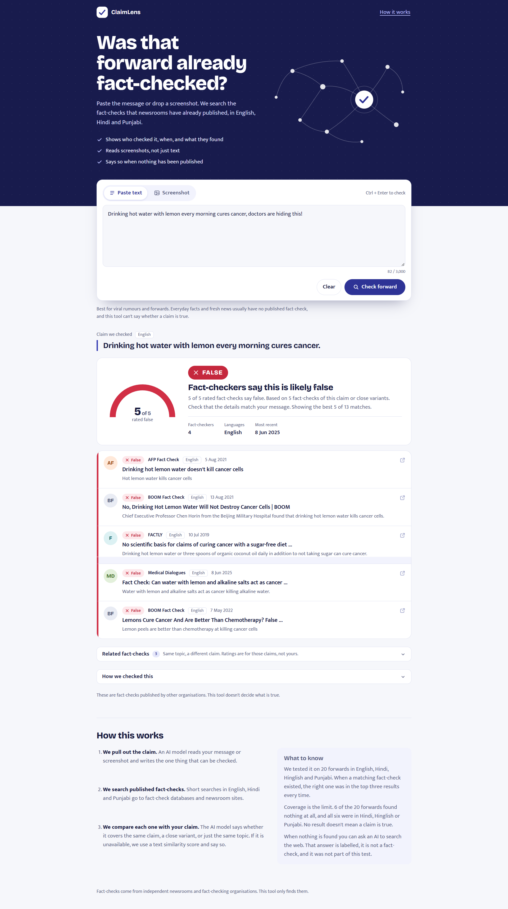
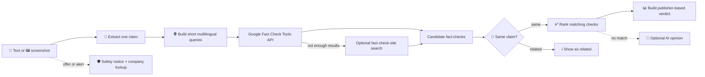

<div align="center">

# 🔍 ClaimLens

### Find the fact-check behind the forward.

Paste a message or upload a screenshot. ClaimLens extracts the claim, searches published fact-checks, and explains what trusted publishers found—in **English, Hindi, Punjabi, and Hinglish**.

<p>
  <a href="https://github.com/rajnishjhajhria/ClaimLens"></a>
  <a href="https://fastapi.tiangolo.com/"></a>
  <a href="https://react.dev/"></a>
  <a href="https://www.python.org/"></a>
</p>



<p>
  <a href="#-quick-start">Quick start</a> ·
  <a href="#-how-it-works">How it works</a> ·
  <a href="#-api">API</a> ·
  <a href="#-privacy--responsible-use">Privacy</a>
</p>

</div>

> **Important:** ClaimLens is a fact-check discovery tool. It points to published work by independent publishers; it does not decide truth on its own and a “no result” does **not** mean a claim is true.

## ✨ Why ClaimLens?

Viral messages often spread through WhatsApp in regional languages or as screenshots. The relevant fact-check may already exist, but finding it requires more than a keyword search. ClaimLens combines claim extraction, multilingual search, semantic matching, and source ratings in one workflow.

### What you can do

| | Capability | Description |
|---|---|---|
| 📝 | **Paste a message** | Submit a forwarded message or any text containing a checkable claim. |
| 🖼️ | **Upload a screenshot** | Extract text from PNG, JPG, or WebP chat screenshots. |
| 🌐 | **Search four language styles** | English, Hindi, Punjabi, and Hinglish are supported. |
| 🧭 | **Find published checks** | Search Google Fact Check Tools, with an optional fact-check-site fallback. |
| 🧠 | **Verify the match** | Separate the same rumour from related topics and unrelated results. |
| 📊 | **Explain the result** | Show publisher, rating, date, and source links before forming a verdict. |
| 🤖 | **Ask AI optionally** | Request a clearly labelled, search-grounded second opinion when no fact-check is found. |
| 🛡️ | **Handle offers safely** | Flag narrow patterns such as loan or account alerts instead of rating them true or false. |
| 📤 | **Share a summary** | Copy a short result or send it through WhatsApp. |
| 🌓 | **Use your preferred theme** | Light, dark, and system themes are available. |

## 🎯 Scope and safety

ClaimLens is designed to locate **published fact-checks**, not to be a general spam, scam, phishing, or financial-advice detector.

| Input | ClaimLens response |
|---|---|
| Viral claim or rumour | Searches for fact-checks about the same claim and shows the sources. |
| No published fact-check | Says that nothing was found and does not infer that the claim is true. |
| Personal offer or account alert | Shows a safety notice and can look up the named company; it does not rate the message. |
| No checkable claim | Explains that there is no claim to verify. |

The optional **Ask AI** feature is not a fact-check. It is labelled clearly, runs only when requested, and requires web sources before presenting a supported or contradicted answer.

## 🧩 How it works



1. **Extract** — Gemini identifies the language, one checkable claim, and short search queries.
2. **Search** — Queries run across English, Hindi, and Punjabi. The Google Fact Check Tools API is preferred; a Tavily fallback can search selected fact-check sites.
3. **Judge** — Results are classified as *same*, *related*, or *unrelated*. The AI judge falls back to a local multilingual embedding model if needed.
4. **Rank** — Matching results are ordered by semantic similarity to the extracted claim.
5. **Explain** — The verdict reflects the fact-checkers’ own ratings. Unrated results do not create a verdict badge.

## 🚀 Quick start

### Prerequisites

- 🐍 Python **3.10+**
- 🟢 Node.js **18+**
- 🐳 Docker Desktop (optional, for the recommended container setup)
- 🔑 [Gemini API key](https://aistudio.google.com/apikey)
- 🔑 [Google Fact Check Tools API key](https://developers.google.com/fact-check/tools/api)
- 🔎 [Tavily API key](https://tavily.com) (optional fallback search)

### Option A: Docker Compose

1. Create `backend/.env` from the template below.
2. Start both services:

   ```bash
   docker compose up --build
   ```

3. Open the app at [http://localhost:3000](http://localhost:3000).
4. Check backend health at [http://localhost:8000/health](http://localhost:8000/health).
5. Stop the services with `Ctrl+C` or:

   ```bash
   docker compose down
   ```

Docker Compose reads `backend/.env` at runtime. The file is excluded from Docker build contexts and must never be committed.

### Option B: Run locally

#### 1. Start the backend

```bash
cd backend
python -m venv .venv

# Windows PowerShell
.venv\Scripts\Activate.ps1

# macOS/Linux
# source .venv/bin/activate

pip install -r requirements.txt
python -m uvicorn main:app --reload --port 8000
```

#### 2. Configure environment variables

Create `backend/.env`:

```ini
GEMINI_API_KEY=your-gemini-key
FACTCHECK_API_KEY=your-fact-check-tools-key
TAVILY_API_KEY=your-tavily-key

JUDGE_MODE=llm
SAME_THRESHOLD=0.86
RELATED_THRESHOLD=0.83
```

#### 3. Start the frontend

```bash
cd frontend
npm install
npm run dev
```

Open [http://localhost:5173](http://localhost:5173). The frontend uses `http://localhost:8000` by default; set `VITE_API_URL` when the backend runs elsewhere.

## ⚙️ Configuration

| Variable | Default | Description |
|---|---|---|
| `GEMINI_API_KEY` | — | Required for extraction, judging, translation, and the optional AI check. |
| `FACTCHECK_API_KEY` | — | Required for Google Fact Check Tools API searches. |
| `TAVILY_API_KEY` | — | Optional web-search fallback. |
| `GEMINI_MODEL` | `gemini-2.5-flash` | Main Gemini model. |
| `GEMINI_FALLBACK_MODEL` | — | Fallback when the main model reaches its quota. |
| `GEMINI_GROUNDED_MODEL` | Main model | Model used by the search-grounded AI check. |
| `JUDGE_MODE` | `embedding` in code | Use `llm` for the AI judge; embeddings remain the automatic fallback. |
| `SAME_THRESHOLD` | `0.86` | Embedding threshold for a same-claim match. |
| `RELATED_THRESHOLD` | `0.83` | Embedding threshold for a related result. |
| `TAVILY_CAN_MATCH` | `0` | Set to `1` to let fallback results count as matches. |
| `RANK_MODEL` | `intfloat/multilingual-e5-small` | Local model used to rank results. |

> **Free-tier note:** Gemini quotas can be small. Responses are cached in `llm_cache.json` and `ai_cache.json`; the app falls back to another model and then embeddings where possible.

## 🔌 API

| Method | Endpoint | Request | Purpose |
|---|---|---|---|
| `GET` | `/health` | — | Service health check. |
| `POST` | `/check` | `{ "text": "..." }` | Extract and search a text claim. |
| `POST` | `/check-image` | Multipart `file` | Read and check a PNG, JPG, or WebP image up to 5 MB. |
| `POST` | `/ai-check` | `{ "claim", "message", "kind" }` | Optional search-grounded AI opinion or company lookup. |
| `POST` | `/translate` | `{ "text", "target" }` | Translate the AI response to English or Hindi. |

`/check` and `/check-image` return statuses such as `match`, `no_match`, `no_claim`, `notice`, or `unjudged`.

`/ai-check` returns:

- `supported`, `contradicted`, `mixed`, `unclear`, or `not_a_claim` for claims
- `registered`, `not_found`, or `unclear` for company lookups

The AI response is `unclear` when it has no supporting web sources.

## 🗂️ Project structure

```text
ClaimLens/
├── backend/
│   ├── main.py              FastAPI routes
│   ├── pipeline.py          Extract → search → judge → rank
│   ├── claim_extractor.py   Gemini extraction and caching
│   ├── factcheck_api.py     Google Fact Check Tools client
│   ├── fallback_search.py   Fact-check-site fallback search
│   ├── reranker.py          Local multilingual matching
│   ├── rank.py              Result ranking
│   ├── ai_check.py          Optional AI check and translation
│   └── requirements.txt     Python dependencies
├── frontend/
│   ├── src/App.jsx          Main page and interaction flow
│   ├── src/Results.jsx      Verdicts, notices, and result rows
│   ├── src/AiCheck.jsx      AI check, company lookup, translation
│   ├── src/Graphics.jsx     Icons and verdict visuals
│   └── src/theme.js         Light, dark, and system themes
├── docker-compose.yml
└── README.md
```

## 📈 Evaluation

The evaluation uses hand-labelled data with a held-out set frozen before scoring.

### Held-out test: 20 forwards

Fourteen forwards had at least one candidate, producing 52 real candidates plus 42 random negatives. The intervals below are 95% bootstrap intervals over claims.

| Method | Strict precision | Strict recall | Family precision | Family recall |
|---|---:|---:|---:|---:|
| **AI judge** | **0.85** [0.59–1.00] | **1.00** | **1.00** | **0.92** |
| Embedding only (≥ 0.86) | 0.85 [0.60–0.97] | 0.56 | 0.92 | 0.48 |
| Always “same” | 0.41 | 1.00 | 0.53 | 1.00 |

- 🥇 The correct fact-check was in the top three for 12 of 12 forwards with one; top-one accuracy was 9 of 12 and MRR was 0.88.
- 🟡 Punjabi is the weakest language in the current evaluation, which is why the AI judge is preferred.
- 📉 Six of 20 forwards found no candidate. No-result coverage, not only matching quality, is the main limitation.

### Screenshot smoke test

The synthetic screenshot set contains 11 English, Hindi, Punjabi, and Hinglish images, including a blurry image and two without a claim:

| Check | Result |
|---|---:|
| Language label correct | 11 / 11 |
| Claim extracted faithfully | 9 / 9 |
| Images with no claim handled | 2 / 2 |
| Text read exactly | 10 / 11 |
| Top result matched the same rumour | 8 / 8 matched rows |

These are clean, computer-generated images and are not a substitute for testing on real phone screenshots.

### Reproduce the evaluation

```bash
cd backend

# Development set
python collect_pairs.py
python apply_relabel.py
python evaluate.py
python eval_llm_judge.py
python eval_hybrid.py

# Held-out set
python collect_pairs_test.py
python merge_labels.py
python evaluate_test.py
```

## 🔒 Privacy and responsible use

- Text and screenshots are sent to **Google Gemini** for extraction. Crop names, phone numbers, OTPs, and other private information before uploading.
- The optional AI check sends the claim to Google Search. The interface explains this before the request.
- Company lookups for offer or account-alert messages can run automatically and send the message text to Gemini and Google Search.
- The server stores response caches locally in `llm_cache.json` and `ai_cache.json`; keep these files and `.env` files out of Git.
- Recent checks and theme preferences are stored only in the browser. The message text is not stored in recent history.
- ClaimLens links to publishers’ fact-checks and does not present its own AI opinion as a fact-check.

## ⚠️ Limitations

- Fact-check coverage is much stronger in English than in Hindi or Punjabi.
- “Same rumour” can include another instance with a different video, date, or amount. Always compare the details.
- The evaluation sets are small, and screenshot tests are synthetic.
- The optional AI opinion can be wrong and is outside the fact-check matching evaluation.
- Search results and free-tier quotas can vary.
- Offer detection is intentionally narrow to reduce false alarms; it can miss offers without a masked account number.
- A company-registration result does not prove that a message came from that company.

## 🛣️ Roadmap

- Translate Punjabi claims to English before embedding
- Index a multilingual fact-check dataset for better coverage
- Add a real-world screenshot test set
- Add Hindi and Punjabi interface text
- Deploy a hosted version

## 🧰 Built with

[](https://fastapi.tiangolo.com/)
[](https://react.dev/)
[](https://vitejs.dev/)
[](https://ai.google.dev/)
[](https://www.docker.com/)

[Google Fact Check Tools API](https://developers.google.com/fact-check/tools/api) · [Tavily](https://tavily.com) · [sentence-transformers](https://www.sbert.net/) · [`multilingual-e5-small`](https://huggingface.co/intfloat/multilingual-e5-small)

Fact-checks shown by the app belong to their publishers, including Alt News, BOOM, The Quint, Vishvas News, AFP, and Full Fact. ClaimLens only links to them.

## 📄 License

Released under the **MIT License**.

<div align="center">

Built with 🧠 NLP, 🔎 search, and 🛡️ responsible product design by **Rajnish**

</div>
